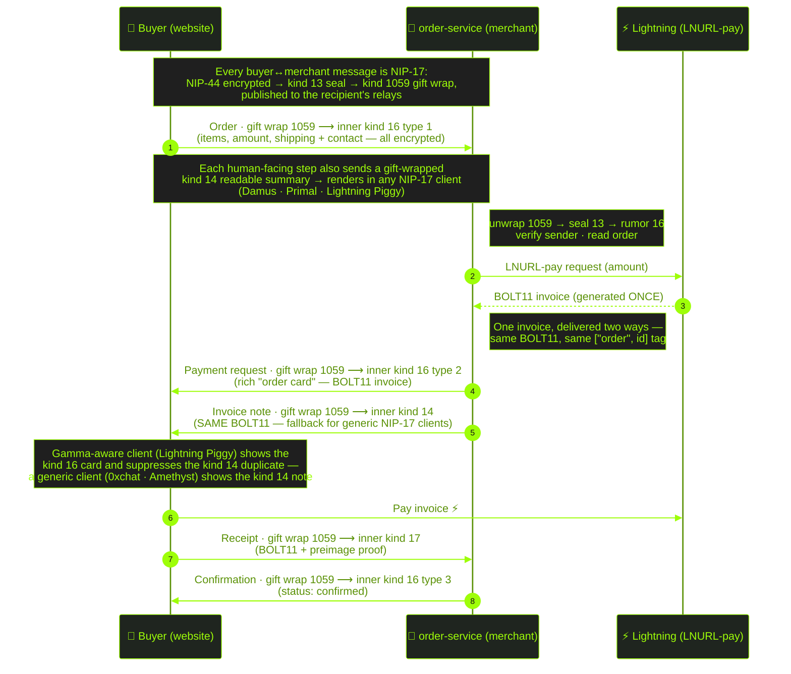

# Robotechy Website

A Nostr-native e-commerce website built with React, using Gamma Markets spec for products and orders, with Lightning Network payments.

## Quick Start

```bash
# Install dependencies and start development server
npm run dev

# Run both frontend and order service together
npm run dev:all

# Run order service separately
npm run dev:orders
```

## Order Processing

The checkout system uses the **Gamma Markets specification** (Kind 16/17 events) for orders and payments, transported end-to-end over **NIP-17 gift wraps**. Every buyer ↔ merchant message — order, payment request, receipt, status — is NIP-44 encrypted, sealed in a kind 13 event, wrapped in a kind 1059 gift wrap, and published to the recipient's relays. Customer PII (name, address, email, phone) rides **inside** the encrypted wrap and never appears in a plaintext public event.

### Dual channel: structured + readable (both encrypted)

Each human-facing step is sent twice, and **both copies are NIP-17 gift-wrapped (encrypted)**:

- **Structured** — the authoritative Gamma Markets inner rumor (kind 16 type 1/2/3/4, or kind 17). The order-service and rich clients (e.g. Lightning Piggy) parse this for structured order cards.
- **Readable** — an informational inner **kind 14** plain-text summary so the same order/receipt/status also renders in any generic NIP-17 client (Damus, Primal).

This is **not** the old leaky dual-send: the previous flow paired a plaintext kind 16 with an unencrypted NIP-04 DM. Now there is no plaintext event and no NIP-04 — both the structured and readable copies are encrypted gift wraps.

### Order Flow



The **order-service** subscribes to kind 1059 gift wraps addressed to the merchant, unwraps each to its inner rumor (authenticating the sender), dispatches orders (kind 16 type 1) and receipts (kind 17), and replies with gift wraps. It prices every order itself from the shop's signed catalog (the buyer's `amount` is only compared, never invoiced) and confirms payment only when the receipt's preimage hashes to the invoice it issued — see *Order-service trust rules* in `docs/SOLUTION_DESIGN.adoc`. It no longer reads plaintext kind 16/17 events or sends NIP-04 DMs.

### One invoice, two surfaces — how clients ignore the duplicate

The payment request is generated as a **single** Lightning invoice (one `generateInvoice` call) and delivered two ways, both gift-wrapped to the buyer:

- a **kind 16 type 2** payment request — the rich, structured "order card" that Gamma-aware clients (and the website) render; and
- a **kind 14** chat note whose `content` carries a short human-readable line **followed by the raw `lnbc…` BOLT11 string** (verbatim, so LN-aware clients make it tappable) — a fallback so generic NIP-17 DM clients (0xchat, Amethyst's DM view) that can't draw a kind 16 card still show the invoice.

**Two correlation keys — use whichever you can access.** The two events are linked by _both_ of the following, and a client only needs one of them to dedupe:

1. **By order id** — both events carry the identical `["order", "<orderId>"]` tag. Clients that retain event tags dedupe on that.
2. **By invoice** — both carry the identical BOLT11: the kind 16's `["payment","lightning","<bolt11>"]` value and the kind 14's `content` text contain the exact same `lnbc…` string. Clients whose message store does **not** persist tags (e.g. Lightning Piggy) dedupe on the exact invoice string extracted from the note text.

Either key works precisely because it is **one** invoice. The dedup contract for client authors:

- **If a client renders the rich kind 16 order card** for an order, it should **suppress** the matching kind 14 chat note — matched by the shared order id _or_ the shared BOLT11. Dedupe **at render time over the full message set**, not at ingest: arrival order is not guaranteed (NIP-59 randomizes gift-wrap timestamps), so the note may arrive before the card.
- **If no kind 16 card is present** (the client can't render it, or it was lost), **show the kind 14 note** — it is the only copy of the invoice the buyer has.

This is safe with respect to issue #7 (DM invoice diverging from the website invoice, enabling double payment): it is the **same BOLT11** on both surfaces, so a single Lightning invoice settles **once** — even if a buyer tries to pay from both, the second settle simply fails at the Lightning layer. No second invoice is ever generated, and no NIP-04 DM is used.

### Event Types

The commerce rumors below (kinds 14/16/17) are carried **inside** a NIP-17 gift wrap (kind 1059) — never published as plaintext. Kind 1059 is the gift-wrap transport itself (NIP-17/NIP-59), listed at the bottom for reference.

| Kind | Type | Description                                                |
| ---- | ---- | ---------------------------------------------------------- |
| 16   | 1    | Order creation (buyer → merchant)                          |
| 16   | 2    | Payment request with invoice (merchant → buyer)            |
| 16   | 3    | Order status update                                        |
| 16   | 4    | Shipping update                                            |
| 17   | -    | Payment receipt with preimage                              |
| 14   | -    | Readable plain-text summary (renders in any NIP-17 client) |
| 1059 | -    | Gift wrap transport (NIP-17/NIP-59) for all of the above   |

### Payment Options

The checkout UI supports multiple payment methods:

- **QR Code** - Scan with any Lightning wallet
- **Copy Invoice** - Paste into wallet apps
- **WebLN** - Browser extensions (Alby, etc.)
- **NWC** - Nostr Wallet Connect
- **Open in Wallet** - `lightning:` URI link

## Order Service Setup

The order processing service runs as a Node.js backend:

```bash
cd order-service
cp .env.example .env
# Edit .env with your merchant nsec and Lightning Address
npm install
npm start
```

### Environment Variables

```bash
MERCHANT_NSEC=nsec1...           # Merchant's secret key
LIGHTNING_ADDRESS=you@getalby.com # Lightning Address for invoices
FALLBACK_RELAYS=wss://relay.weeksfamily.me,wss://relay.ditto.pub,wss://relay.primal.net,wss://relay.damus.io,wss://relay.plebeian.market
```

## Development

```bash
npm run dev          # Frontend only
npm run dev:orders   # Order service only
npm run dev:all      # Both together
npm run test         # Run all tests
npm run build        # Production build
npm run deploy       # Deploy to Nostr
```

## Docker

Build and run as a single container with both frontend and order service:

```bash
# Build the image
docker build -t robotechy:latest .

# Run with order service enabled
docker run -d \
  -p 3000:3000 \
  -e MERCHANT_NSEC=nsec1... \
  -e LIGHTNING_ADDRESS=yourname@getalby.com \
  -e MERCHANT_NPUB=npub1... \
  -v robotechy-backups:/data/backups \
  --name robotechy \
  robotechy:latest

# Run frontend only (no order processing)
docker run -d -p 3000:3000 --name robotechy robotechy:latest
```

The frontend is served on port 3000. The order service connects outbound to Nostr relays (no inbound port needed).

### Environment Variables

| Variable            | Required   | Description                               |
| ------------------- | ---------- | ----------------------------------------- |
| `MERCHANT_NSEC`     | For orders | Merchant's Nostr secret key (nsec format) |
| `LIGHTNING_ADDRESS` | For orders | Lightning Address for invoice generation  |
| `FALLBACK_RELAYS`   | No         | Comma-separated relay URLs (has defaults) |
| `MERCHANT_NPUB`     | For backups | Shop public key; enables the event archiver (see [Backups & restore](#backups--restore)) |

Mount a volume at `/data/backups` so the archive survives rebuilds.

If `MERCHANT_NSEC` or `LIGHTNING_ADDRESS` are not set, the container runs frontend-only mode.

## Relays

The shop's catalog, profile and story notes live on these relays (`src/lib/shopRelays.ts`, mirrored in `order-service/lib/archiveConfig.js` and the order-service `FALLBACK_RELAYS` default):

| Relay | Notes |
| --- | --- |
| `wss://relay.weeksfamily.me` | Family relay (strfry on black-panther). First in the list, but everything tolerates it being unreachable |
| `wss://relay.ditto.pub` | Long-standing home of the shop's events |
| `wss://relay.primal.net` | Accepts and serves the shop |
| `wss://relay.damus.io` | Accepts the shop (rate-limits aggressively) |
| `wss://relay.plebeian.market` | Marketplace relay; accepts the shop |

`nos.lol`, `relay.nostr.band` and `relay.nostr.net` were removed: they are dead or never held the shop's events.

Shop data is always queried from these relays directly (outbox model), even when a logged-in visitor has their own relay list. A query resolves about 1 s after the **first** relay finishes (NPool `eoseTimeout`), with a hard 3 s ceiling, so dead relays never hold the page.

## Backups & restore

The container keeps an append-only archive of every signed event the shop key publishes. It needs only the shop's **public** key (`MERCHANT_NPUB`); no nsec is ever read for backups.

### What runs

`order-service/archiver.js` starts from `docker-entrypoint.sh` when `MERCHANT_NPUB` is set. If it exits, it is restarted, at most once a minute. It never takes the shop down.

- **Live:** one subscription across the shop relays saves each publish within seconds. It is re-armed every 30 minutes to pick up relays that were down.
- **On startup, and nightly at 03:00 UTC:** a full sync from each relay (3 REQs per relay), which rewrites `latest.jsonl` and the catalog snapshot.
- **Nightly only:**
  - a dated tarball, rotated after 90 days;
  - an optional copy to `BACKUP_COPY_DIR`;
  - an optional status POST to `N8N_WEBHOOK_URL`.

Archived kinds: `0` profile, `1` story notes, `3` contacts, `5` deletions (kept as evidence, never re-broadcast), `10002` relay list, `30402` products, `30405` collections and `30406` shipping options.

### Layout (`/data/backups` — mount a volume here)

```
/data/backups/
  events/<kind>/<d-tag | pubkey | id>/<created_at>.json   original signed events, one file per version
  events/latest.jsonl                                     newest version of every event
  catalog-snapshot.json                                   also published as /catalog-snapshot.json on the site
  tarballs/events-YYYY-MM-DD.tar.gz                       nightly, 90-day rotation
  monitor-state.json                                      last night's listing count + seen deletions
```

Addressable kinds are grouped by d-tag, replaceable kinds (0, 3, 10002) by pubkey, and regular kinds by event id. Files are **never overwritten or deleted**. Only the dated tarballs rotate.

When the shop key publishes a kind-5 deletion, the archiver logs a `WARNING` naming the deleted product, and keeps the archived copy.

### Cached snapshot (the site never renders blank)

The archiver writes `catalog-snapshot.json`: the newest signed version of the profile, the catalog, and the last 100 notes, with deleted events left out. It writes the file to `/data/backups` and to `dist/`, so the site serves it at `/catalog-snapshot.json`.

1. The storefront (`src/hooks/useShopQuery.ts`) loads the snapshot first.
2. It **verifies every signature in the browser** against the shop pubkey (`src/lib/catalogSnapshot.ts`) and shows the snapshot immediately.
3. Live relay data is merged in as it arrives: the newest version of each event wins, and the shop's deletions are applied.

If every relay is down, the site still shows the last good catalog. A tampered snapshot can only lose events, never forge them.

### Restore

`restore.js` is a **dry run by default**. Pass `--execute` to act.

```bash
# What would be restored? (all catalog + profile/relay list/contacts, newest versions)
docker exec <container> node /app/order-service/restore.js

# One product, by d-tag: dry run, then for real
docker exec <container> node /app/order-service/restore.js --d <product-d-tag>
docker exec <container> node /app/order-service/restore.js --d <product-d-tag> --execute

# The version that was live at a given time
docker exec <container> node /app/order-service/restore.js --d <tag> --at 1767225600
```

| Mode | When | Key needed |
| --- | --- | --- |
| `--mode rebroadcast` (default) | Relays lost the data. Re-sends the **original signed events** | None |
| `--mode republish` | The product was **deleted** (kind 5), or you want to roll back to an older version. Relays refuse a deleted event, and keep only the newest replaceable one | Owner signs in the browser |

The dry run warns when an event was deleted or superseded, and when rebroadcast therefore won't work.

**Republish (owner signs in the browser).** `--mode republish` prints **unsigned** templates: the original tags and content with a fresh `created_at`. Add `--execute --out /data/backups/restore.json` to write them to a file. The container never holds the key. To publish:

1. Log in to the site as the shop owner (browser extension / NIP-07 signer).
2. Open the product editor for that product (or "Add product" if it's gone), paste the title, description, price and images from the template, and save. The browser signs a fresh event with your key.
3. Re-run `restore.js` in dry-run mode, or wait for the archiver, to confirm the new version is archived.

### Monitoring (n8n)

When `N8N_WEBHOOK_URL` is set, the nightly sync POSTs:

```json
{
  "shop": "robotechy", "merchantPubkey": "…", "timestamp": "2026-10-12T03:00:04Z",
  "liveListings": 4, "previousListings": 4, "listingDropPct": 0,
  "archivedListings": 4, "liveVsArchivedPct": 100,
  "archivedEvents": 42, "relaysReached": ["wss://relay.ditto.pub", "…"],
  "newDeletions": [{ "id": "…", "created_at": 0, "targets": ["a:30402:…"], "archivedTargets": [{ "kind": 30402, "title": "…" }] }]
}
```

Suggested n8n rule: Webhook → IF → alert (email / Signal / Nostr DM) when **any** of these hold:

- `listingDropPct > 20`: live listings fell more than 20% since last night;
- `liveVsArchivedPct < 80`: relays are serving less than 80% of what we have archived;
- `newDeletions.length > 0`: the shop key published a deletion;
- `relaysReached.length == 0`: no relay answered.

### Environment

| Variable | Default | Purpose |
| --- | --- | --- |
| `MERCHANT_NPUB` | (required for backups) | Shop public key, npub or hex. Never an nsec |
| `BACKUP_DIR` | `/data/backups` | Archive root |
| `ARCHIVE_RELAYS` | the shop relays | Relays to archive from; `FALLBACK_RELAYS` are merged in |
| `BACKUP_COPY_DIR` | (unset) | Copy nightly tarballs here, e.g. a mounted Nextcloud folder. Never pruned |
| `N8N_WEBHOOK_URL` | (unset) | Nightly status POST |
| `BACKUP_RETENTION_DAYS` | `90` | Tarball retention |
| `NIGHTLY_SYNC_HOUR_UTC` | `3` | Hour of the nightly sync |
| `SNAPSHOT_PUBLIC_PATH` | `/app/dist/catalog-snapshot.json` | Where the site serves the snapshot from |

## Technology Stack

- **Frontend**: React 18, TypeScript, Vite, TailwindCSS, shadcn/ui
- **Nostr**: Nostrify, nostr-tools
- **Orders**: Gamma Markets spec (Kind 16/17), NIP-17 gift-wrapped end-to-end
- **Payments**: Lightning Network via LNURL-pay
- **Messaging**: NIP-17 gift wraps (NIP-44 encryption, kind 13 seal, kind 1059 wrap)
- **Container**: Docker with Node.js 22 Alpine
